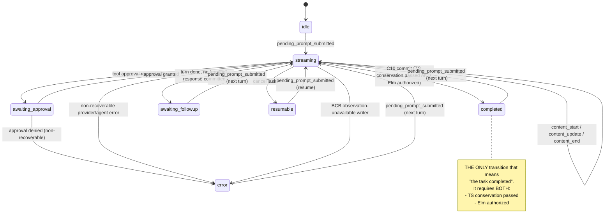

# Chart 01 — Task / Turn Phase

The task-level `TurnState.phase` machine.

**Owner:** `TurnStateTracker` (`apps/vscode/src/sdk/turn-state-tracker.ts`),
written through the `setTurnPhase(phase, anchorTs, writerId)` seam.
Every write carries a `writerId` (the provenance identity), recorded
by the turn-state-writer-provenance diagnostics.

**Authority note:** `phase` is a TASK-CURRENT property. It describes
the CURRENT turn, not any historical row. It is NOT a per-row
authority — see [chart 04](04-completion-presentation.md) for the
per-row authority and why the two must not be confused.

## Load-bearing transitions

### T-01 — `idle` → `streaming`

| Field | Value |
|---|---|
| source | `apps/vscode/src/sdk/sdk-session-event-coordinator.ts:2997` |
| predicate | `event.type === "pending_prompt_submitted"` |
| effect | `setTurnPhase("streaming", undefined, "session-event-pending-prompt-submitted")`; `sessions.setRunning(true)`; `messageTranslatorState.clearTurnOutcome()` |
| test | `apps/vscode/src/sdk/__tests__/sdk-session-event-coordinator.test.ts` |
| kind | observed |

### T-02 — `streaming` → `completed` (the C10 commit)

| Field | Value |
|---|---|
| source | `apps/vscode/src/sdk/sdk-session-event-coordinator.ts:3768` |
| predicate | `result.turnComplete` AND `wasAttemptCompletionSeen()` AND `wasTerminalResponseCommittedThisTurn()` AND `!wasErrorSeen()` AND NOT (BCB hold) AND `checkElmCompletionAuthority(...) === true` |
| effect | `setTurnPhase("completed", undefined, "session-event-turn-complete-completed")` then `captureContinuationCardinalityAuthorityRecord({stage: "task_completion_committed", completionId})` — the C10 record |
| test | `apps/vscode/src/sdk/__tests__/c9-c10-statechart-causal-repair01.c9c10scr01.test.ts` (GREEN control) |
| kind | observed |

**Load-bearing detail.** The `checkElmCompletionAuthority` gate is the
LAST gate before the effect. It returns `false` for an Elm `hold` OR
an Elm `failure` (there is NO silent TS fallback — see
`apps/vscode/src/sdk/completion-authority-elm-authority.ts`). A `false`
return suppresses the C10 commit entirely.

### T-03 — `streaming` → `awaiting_followup`

| Field | Value |
|---|---|
| source | `apps/vscode/src/sdk/sdk-session-event-coordinator.ts:3815` |
| predicate | `result.turnComplete` AND NOT `wasAttemptCompletionSeen()` (no completion tool was declared) |
| effect | `setTurnPhase("awaiting_followup", …)` — the turn yields to the user; the composer stays enabled |
| test | `apps/vscode/src/sdk/__tests__/task-terminal-divergence-red01.tdd-red01.test.ts` |
| kind | observed |

### T-04 — `streaming` → `error`

| Field | Value |
|---|---|
| source | `apps/vscode/src/sdk/sdk-session-event-coordinator.ts:3246` |
| predicate | `wasErrorSeen()` — a non-recoverable provider/agent error surfaced this turn |
| effect | `setTurnPhase("error", undefined, "session-event-turn-complete-error")`; an `ask:"api_req_failed"` row offers Retry / Start New Task |
| test | `apps/vscode/src/sdk/__tests__/task-terminal-divergence-red01.tdd-red01.test.ts` (TDD-01) |
| kind | observed |

### T-05 — `streaming` → `resumable` (cancellation)

| Field | Value |
|---|---|
| source | `apps/vscode/src/sdk/sdk-session-event-coordinator.ts:1108` |
| predicate | `cancelTask` — the user cancelled the turn |
| effect | `setTurnPhase("resumable", undefined, "session-event-turn-complete-containment-failed-resumable")`; the footer shows Resume Task |
| test | `apps/vscode/src/sdk/__tests__/task-terminal-divergence-red01.tdd-red01.test.ts` (TDD-10a) |
| kind | observed |

### T-06 — the turn-complete straggler guard

| Field | Value |
|---|---|
| source | `apps/vscode/src/sdk/sdk-session-event-coordinator.ts:3242` |
| predicate | `!activeSession.isRunning && getTurnPhase() === "resumable"` |
| effect | The turn-complete phase write is SKIPPED, preserving the cancel-set `resumable` phase |
| test | `apps/vscode/src/sdk/__tests__/task-terminal-divergence-red01.tdd-red01.test.ts` (TDD-10a) |
| kind | observed |

### T-07 — `streaming` → `error` (BCB observation-unavailable writer)

| Field | Value |
|---|---|
| source | `apps/vscode/src/sdk/sdk-session-event-coordinator.ts:3610` |
| predicate | The BCB barrier held AND `canObserveHeldResults === false` (the resumed turn's tool registry has no `command_status`) AND the same obligation was not already marked `observation_unavailable` |
| effect | `setTurnPhase("error", …)` with the BCB writer id; a bounded `observation_unavailable` outcome is published instead of a useless continuation |
| test | `apps/vscode/src/sdk/__tests__/bcb-observation-unavailable-capture.bcapt01.test.ts` |
| kind | observed |

### T-08 — `awaiting_followup` / `completed` / `error` → `streaming` (next turn)

| Field | Value |
|---|---|
| source | `apps/vscode/src/sdk/sdk-session-event-coordinator.ts:2968-2997` |
| predicate | `event.type === "pending_prompt_submitted"` |
| effect | The turn outcome is cleared; the phase returns to `streaming` |
| test | `apps/vscode/src/sdk/__tests__/sdk-session-event-coordinator.test.ts` |
| kind | observed |

## The TaskHeader projection

| Field | Value |
|---|---|
| source | `apps/vscode/webview-ui/src/components/chat/task-header/taskHeaderTelemetryHelpers.ts:146` |
| predicate | `stateLabel(turnState.phase)` |
| effect | `streaming` → label `"Working"`, glyph `"●"`, `live: true`; `completed` → the terminal label |
| test | `apps/vscode/webview-ui/src/components/chat/task-header/taskHeaderTelemetryHelpers.test.ts` |
| kind | observed |

**This is why the LIVE incident showed "Working".** The Elm HOLD kept
the task phase at `streaming`, and `streaming` projects to "Working" —
correctly, because the task genuinely had NOT completed.

## Why `phase` is not a per-row authority

A historical completion row must keep its "Completed" badge even when
a NEWER turn is running (the phase is then `streaming`). That is why
the per-row marker exists — see [chart 04](04-completion-presentation.md).
The converse also holds: a row that was published while the phase was
`streaming` and was NEVER committed must NOT keep a badge.

The two facts are reconciled by the marker being published by the
COMPLETION COMMIT (the C10 commit, `promoteCompletionAuthorityMarker`) and
NOT at the translation seam. The LIVE `content_end` publishes the finalized
row WITHOUT the marker; the marker is added only when the C10 commit
succeeds, and it is RECOVERED on reopen from a verified persisted
completion identity. (Before the C9C10CDAP01 correction the marker was
stamped at the publication seam and RETRACTED when the commit did not
happen — that was retrospective and violated the temporal invariant.)
