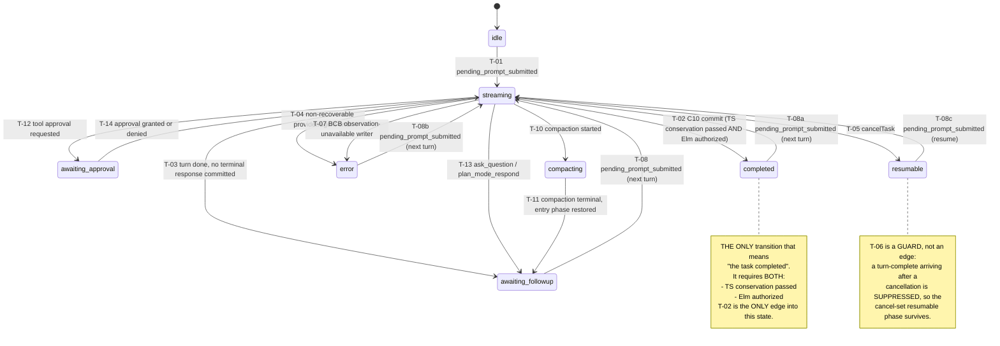

# Chart 01 — Task / Turn Phase

The task-level `TurnState.phase` machine.

**Owner:** `TurnStateTracker` (`apps/vscode/src/sdk/turn-state-tracker.ts`),
written through the `setTurnPhase(phase, anchorTs, writerId)` seam.
Every write carries a `writerId` (the provenance identity), recorded
by the turn-state-writer-provenance diagnostics.

**Authority note:** `phase` is a TASK-CURRENT property. It describes
the CURRENT turn, not any historical row. It is NOT a per-row
authority — see [chart 04](04-completion-presentation.md) for the
per-row authority and why the two must not be confused.

## Load-bearing transitions

Every row below is bound to an executable witness in
`apps/vscode/src/sdk/__tests__/turn-phase-contract01.tpc01.test.ts`.
The generated coverage report is
`docs/acts/ACT-CLINEMM-LIFECYCLE-EXECUTABLE-TURN-PHASE-CONTRACT01/coverage-report.md`.

**The claim taxonomy is a DIFFERENT axis from the `kind` column above.**
`claim_kind` records what the claim IS (a TRANSITION, a GUARD, a
PROJECTION); the `kind` column records the evidence maturity. A GUARD
claim is proven by an executable assertion and carries **NO** Mermaid
edge — it is a SUPPRESSION of a write, not a transition.

| id | kind | from → to | production writer | source |
|---|---|---|---|---|
| T-01 | TRANSITION | `idle` → `streaming` | `session-event-pending-prompt-submitted` | `sdk-session-event-coordinator.ts:3091` |
| T-02 | TRANSITION | `streaming` → `completed` | `session-event-turn-complete-completed` | `sdk-session-event-coordinator.ts:3879` |
| T-03 | TRANSITION | `streaming` → `awaiting_followup` | `session-event-turn-complete-resumable-straggler-preserve` | `sdk-session-event-coordinator.ts:4176` |
| T-04 | TRANSITION | `streaming` → `error` | `session-event-turn-complete-error` | `sdk-session-event-coordinator.ts:3343` |
| T-05 | TRANSITION | `streaming` → `resumable` | `controller-cancel-task` | `SdkController.ts:4297` |
| T-06 | **GUARD** | (no edge — suppresses a write) | — | `sdk-session-event-coordinator.ts:3338` |
| T-07 | TRANSITION | `streaming` → `error` | `session-event-bcb-blocked-observation-unavailable` | `sdk-session-event-coordinator.ts:3704` |
| T-08 | TRANSITION | `awaiting_followup` → `streaming` | `session-event-pending-prompt-submitted` | `sdk-session-event-coordinator.ts:3091` |
| T-09 | **PROJECTION** | (no edge — a projection) | — | `taskHeaderTelemetryHelpers.ts:146` |
| T-10 | TRANSITION | `streaming` → `compacting` | `compaction-enter` | `sdk-compaction-coordinator.ts:488` |
| T-11 | TRANSITION | `compacting` → (entry phase) | `compaction-restore-entry-preserve` | `sdk-compaction-coordinator.ts:510` |
| T-12 | TRANSITION | `streaming` → `awaiting_approval` | `interaction-handle-tool-approval` | `sdk-interaction-coordinator.ts:740` |
| T-13 | TRANSITION | `streaming` → `awaiting_followup` | `interaction-handle-ask-question` | `sdk-interaction-coordinator.ts:898` |
| T-14 | TRANSITION | `awaiting_approval` → `streaming` | `interaction-resolve-tool-approval-yes-no` | `sdk-interaction-coordinator.ts:941` |

### T-01 — `idle` → `streaming`

| Field | Value |
|---|---|
| source | `apps/vscode/src/sdk/sdk-session-event-coordinator.ts:3091` |
| predicate | `event.type === "pending_prompt_submitted"` |
| effect | `setTurnPhase("streaming", undefined, "session-event-pending-prompt-submitted")`; `sessions.setRunning(true)`; `messageTranslatorState.clearTurnOutcome()` |
| test | `apps/vscode/src/sdk/__tests__/turn-phase-contract01.tpc01.test.ts` |
| kind | observed |

### T-02 — `streaming` → `completed` (the C10 commit)

| Field | Value |
|---|---|
| source | `apps/vscode/src/sdk/sdk-session-event-coordinator.ts:3879` |
| predicate | `result.turnComplete` AND `wasAttemptCompletionSeen()` AND `wasTerminalResponseCommittedThisTurn()` AND `!wasErrorSeen()` AND NOT (BCB hold) AND `checkElmCompletionAuthority(...) === true` |
| effect | `setTurnPhase("completed", undefined, "session-event-turn-complete-completed")` then `captureContinuationCardinalityAuthorityRecord({stage: "task_completion_committed", completionId})` — the C10 record |
| test | `apps/vscode/src/sdk/__tests__/turn-phase-contract01.tpc01.test.ts` |
| kind | observed |

**Load-bearing detail.** The `checkElmCompletionAuthority` gate is the
LAST gate before the effect. It returns `false` for an Elm `hold` OR
an Elm `failure` (there is NO silent TS fallback — see
`apps/vscode/src/sdk/completion-authority-elm-authority.ts`). A `false`
return suppresses the C10 commit entirely. The witness proves this
against the REAL coordinator for BOTH the HOLD and the FAILURE, and
proves that the suppressed path leaves the committed phase AND its seq
UNCHANGED.

### T-03 — `streaming` → `awaiting_followup`

| Field | Value |
|---|---|
| source | `apps/vscode/src/sdk/sdk-session-event-coordinator.ts:4176` |
| predicate | `result.turnComplete` AND NOT `wasAttemptCompletionSeen()` (no completion tool was declared) AND no outstanding autonomous work |
| effect | `setTurnPhase("awaiting_followup", undefined, "session-event-turn-complete-resumable-straggler-preserve")` — the turn yields to the user; the composer stays enabled |
| test | `apps/vscode/src/sdk/__tests__/turn-phase-contract01.tpc01.test.ts` |
| kind | observed |

**This is NOT completion.** The witness proves that no `completed`
phase is committed for this turn, and that the REAL webview
follow-up selector (`turnAllowsFollowup`) accepts the committed phase
so the composer stays enabled. The phase is distinct from
`awaiting_approval` and from `compacting`.

### T-04 — `streaming` → `error`

| Field | Value |
|---|---|
| source | `apps/vscode/src/sdk/sdk-session-event-coordinator.ts:3343` |
| predicate | `wasErrorSeen()` |
| effect | `setTurnPhase("error", undefined, "session-event-turn-complete-error")`; `ask:"api_req_failed"` offers Retry / Start New Task |
| test | `apps/vscode/src/sdk/__tests__/turn-phase-contract01.tpc01.test.ts` |
| kind | observed |

### T-05 — `streaming` → `resumable` (cancellation)

| Field | Value |
|---|---|
| source | `apps/vscode/src/sdk/SdkController.ts:4297` (the `controller-cancel-task` writer) and `apps/vscode/src/sdk/sdk-task-control-coordinator.ts:160` (the no-active-session recovery writer) |
| predicate | `cancelTask` — the user cancelled the turn |
| effect | `setTurnPhase("resumable", undefined, "controller-cancel-task")` BEFORE the abort is awaited; the footer shows Resume Task |
| test | `apps/vscode/src/sdk/__tests__/turn-phase-contract01.tpc01.test.ts` |
| kind | observed |

**The fence ordering matters.** The phase is committed BEFORE the
abort is awaited so any straggler SDK event lands on the wrong side of
the cancel fence. The witness asserts the fence is raised BEFORE the
phase publication, and that a cancellation never OVERWRITES an
already-committed terminal phase (`completed` / `error` / `resumable`
stand).

### T-06 — the turn-complete straggler GUARD (NO edge)

| Field | Value |
|---|---|
| source | `apps/vscode/src/sdk/sdk-session-event-coordinator.ts:3338` |
| predicate | `!activeSession.isRunning && getTurnPhase() === "resumable"` |
| effect | The turn-complete phase write is SKIPPED entirely — NO write occurs, so the cancel-set `resumable` phase AND its seq are preserved |
| test | `apps/vscode/src/sdk/__tests__/turn-phase-contract01.tpc01.test.ts` |
| kind | observed |

**This claim carries NO Mermaid edge.** A GUARD SUPPRESSES a write; it
is not a transition. Drawing it as an edge would invent a state change
that does not happen. The witness asserts BOTH that the committed
phase is preserved AND that the committed seq is UNCHANGED (proving
no write occurred at all), and separately that a LEGITIMATE new turn
after the cancellation DOES advance to `streaming`.

### T-07 — `streaming` → `error` (BCB observation-unavailable)

| Field | Value |
|---|---|
| source | `apps/vscode/src/sdk/sdk-session-event-coordinator.ts:3704` |
| predicate | The BCB barrier held AND `canObserveHeldResults === false` (the resumed turn's tool registry has no `command_status`) AND the same obligation was not already marked `observation_unavailable` |
| effect | `setTurnPhase("error", undefined, "session-event-bcb-blocked-observation-unavailable")`; a bounded `observation_unavailable` outcome is published instead of a useless continuation |
| test | `apps/vscode/src/sdk/__tests__/turn-phase-contract01.tpc01.test.ts` |
| kind | observed |

**T-07 is NOT T-04.** Both commit `error`, but through DIFFERENT writer
identities and DIFFERENT causal predicates. The witness asserts the
distinction explicitly in both directions.

### T-08 — the grouped next-turn resumption (FOUR distinct source states)

| Field | Value |
|---|---|
| source | `apps/vscode/src/sdk/sdk-session-event-coordinator.ts:3091` |
| predicate | `event.type === "pending_prompt_submitted"` |
| effect | The turn outcome is cleared; the phase returns to `streaming` |
| test | `apps/vscode/src/sdk/__tests__/turn-phase-contract01.tpc01.test.ts` |
| kind | observed |

T-08 is a GROUPED contract over FOUR genuinely distinct runtime source
states. A slash-delimited source string is NOT a runtime phase, so
the diagram draws four separate edges and the witness exercises each
source state SEPARATELY:

| edge id | source state | target state |
|---|---|---|
| T-08 | `awaiting_followup` | `streaming` |
| T-08a | `completed` | `streaming` |
| T-08b | `error` | `streaming` |
| T-08c | `resumable` | `streaming` |

### T-10 — `streaming` → `compacting` (the compaction system transition)

| Field | Value |
|---|---|
| source | `apps/vscode/src/sdk/sdk-compaction-coordinator.ts:488` |
| predicate | the compaction divider enters the `started` state |
| effect | `setTurnPhase("compacting", entry.anchorTs, "compaction-enter")` — a HOST-OWNED SYSTEM TRANSITION, not model/tool work and emphatically not a human wait |
| test | `apps/vscode/src/sdk/__tests__/turn-phase-contract01.tpc01.test.ts` |
| kind | observed |

The phase is entered BEFORE the divider is emitted, so every consumer
that samples state while the divider is visible sees runtime ownership
rather than the phase the previous turn left behind. The witness
samples the committed phase at the exact instant the "Compacting
context" divider becomes visible.

### T-11 — `compacting` → (the entry phase) (the compaction restore)

| Field | Value |
|---|---|
| source | `apps/vscode/src/sdk/sdk-compaction-coordinator.ts:510` |
| predicate | the compaction reaches any terminal status |
| effect | `setTurnPhase(entry.phase, entry.anchorTs, "compaction-restore-entry-preserve")` — the ENTRY phase AND its anchor are restored, making compaction a BOUNDED window rather than a new terminal state |
| test | `apps/vscode/src/sdk/__tests__/turn-phase-contract01.tpc01.test.ts` |
| kind | observed |

The restore target is the phase that was current on ENTRY, so the
diagram shows the canonical entry phase (`awaiting_followup`) as the
representative edge. The witness proves the restore preserves the
ENTRY phase and its anchor.

### T-12 — `streaming` → `awaiting_approval` (tool approval requested)

| Field | Value |
|---|---|
| source | `apps/vscode/src/sdk/sdk-interaction-coordinator.ts:740` |
| predicate | a tool/command/mcp/subagent approval is requested |
| effect | `setTurnPhase("awaiting_approval", toolAskMessage.ts, "interaction-handle-tool-approval")` — the anchor IS the approval ask message's ts |
| test | `apps/vscode/src/sdk/__tests__/turn-phase-contract01.tpc01.test.ts` |
| kind | observed |

### T-13 — `streaming` → `awaiting_followup` (ask_question / plan_mode_respond)

| Field | Value |
|---|---|
| source | `apps/vscode/src/sdk/sdk-interaction-coordinator.ts:898` |
| predicate | `handleAskQuestion` / `plan_mode_respond` |
| effect | `setTurnPhase("awaiting_followup", askMessage.ts, "interaction-handle-ask-question")` — the anchor IS the ask message's ts |
| test | `apps/vscode/src/sdk/__tests__/turn-phase-contract01.tpc01.test.ts` |
| kind | observed |

### T-14 — `awaiting_approval` → `streaming` (the approval is resolved)

| Field | Value |
|---|---|
| source | `apps/vscode/src/sdk/sdk-interaction-coordinator.ts:941` |
| predicate | the pending tool approval is resolved (approved OR denied) |
| effect | `setTurnPhase("streaming", undefined, "interaction-resolve-tool-approval-yes-no")` — the anchor is CLEARED, because the approval is no longer pending |
| test | `apps/vscode/src/sdk/__tests__/turn-phase-contract01.tpc01.test.ts` |
| kind | observed |

## The eight-phase vocabulary

`TurnPhase` (`apps/vscode/src/shared/ExtensionMessage.ts`) has exactly EIGHT
values. Every one is accounted for below with its production writers and
its TaskHeader projection authority.

| phase | production writers | projection authority | TaskHeader label |
|---|---|---|---|
| `idle` | `task-control-idle-fallback`, `controller-clear-task`, `controller-restore-checkpoint`, `controller-epoch-transition-reseed`, `followup-on-follow-up-abandoned` | shadow / legacy | Idle (`○`, not live) |
| `streaming` | `session-event-pending-prompt-submitted`, `task-start-init-task`, `task-start-reinit-existing-task`, `controller-ask-response`, `controller-edit-message-and-regenerate`, `interaction-resolve-tool-approval-yes-no`, `interaction-resolve-ask-question`, `interaction-resolve-mistake-limit`, `followup-auto-continue-starting` | shadow / legacy | Working (`●`, live) |
| `awaiting_approval` | `interaction-handle-tool-approval`, `interaction-resolve-tool-approval-message-response` | shadow / legacy | Approval (`?`, live) |
| `awaiting_followup` | `session-event-turn-complete-awaiting-followup`, `session-event-turn-complete-awaiting-followup-liveness`, `session-event-turn-complete-resumable-straggler-preserve`, `interaction-handle-ask-question`, `interaction-handle-mistake-limit` | **host** | Your turn (`↳`, live) |
| `compacting` | `compaction-enter` | **host** | Compacting (`⌄`, live) |
| `completed` | `session-event-turn-complete-completed`, `task-control-resume-ask` | shadow / legacy | Complete (`✓`, not live) |
| `error` | `session-event-turn-complete-error`, `session-event-bcb-blocked-observation-unavailable`, `controller-on-send-error`, `controller-emit-cline-auth-error`, `controller-emit-cline-balance-error`, `followup-auto-continue-failed`, `followup-on-resume-failed` | **host** | Error (`!`, not live) |
| `resumable` | `controller-cancel-task`, `task-control-cancel-no-active-session`, `task-control-resumable-ask`, `mode-coordinator-mode-switch-resumable`, `session-event-turn-complete-containment-failed-resumable` | **host** | Paused (`↻`, not live) |

**The phase-dependent restore writers.** The three compaction restore
writers (`compaction-restore-entry-preserve`,
`compaction-restore-canonical-unavailable-preserve`,
`compaction-restore-canonical-resolved`) do NOT commit a FIXED phase —
they commit the phase that was current when the bounded window opened.
They are therefore listed separately from the phase → writers map rather
than being mis-attributed to `compacting`.

**The host override is not a shadow projection.** The canonical shadow
cannot represent `compacting`, `awaiting_followup`, `error` or
`resumable`, so `selectTaskHeaderPresentation`
(`apps/vscode/src/sdk/task-state-shadow-arbiter-mapper.ts`) gives the
host precedence for exactly those four. The remaining four are rendered
from the canonical shadow when a shadow observation exists and from the
legacy absence fallback otherwise.

## The TaskHeader projection (T-09)

T-09 is a PROJECTION, not a transition. The TaskHeader label is a
function of the committed phase (and the presentation authority); it
is NOT a lifecycle state and carries NO Mermaid edge.

| Field | Value |
|---|---|
| source | `apps/vscode/webview-ui/src/components/chat/task-header/taskHeaderTelemetryHelpers.ts#stateLabel` and `#taskHeaderPresentationStateLabel` |
| predicate | `taskHeaderPresentationStateLabel(taskHeaderPresentation, turnState)` — the production entry point |
| effect | `streaming` → label `"Working"`, glyph `"●"`, `live: true`; `completed` → `"Complete"`; `compacting` → `"Compacting"`; `awaiting_followup` → `"Your turn"`; `awaiting_approval` → `"Approval"`; `error` → `"Error"`; `resumable` → `"Paused"`; `idle` → `"Idle"` |
| test | `apps/vscode/src/sdk/__tests__/turn-phase-contract01.tpc01.test.ts` |
| kind | observed |

**`stateLabel()` alone is NOT the complete display-authority contract.**
`stateLabel` is the pure `TurnPhase → (label, glyph, live)` mapping.
The PRODUCTION entry point is `taskHeaderPresentationStateLabel`, which
reads the canonical `taskHeaderPresentation` projection when it is
present and falls back to the legacy `turnState.phase` derivation only
when the projection is ABSENT (Hub/Remote / pre-observation). The
authority itself is resolved by the HOST selector
`selectTaskHeaderPresentation`
(`apps/vscode/src/sdk/task-state-shadow-arbiter-mapper.ts`), which
encodes the three-source precedence:

1. host-owned override (`compacting` / `awaiting_followup` / `error` /
   `resumable`),
2. the canonical `@cline/agents` TaskStateShadow projection,
3. the legacy absence fallback.

The witness proves all three branches, and proves that a `stateLabel()`
test alone would NOT have caught a wrong phase source.

**This is why the LIVE incident showed "Working".** The Elm HOLD kept
the task phase at `streaming`, and `streaming` projects to "Working" —
correctly, because the task genuinely had NOT completed.

## Why `phase` is not a per-row authority

A historical completion row must keep its "Completed" badge even when
a NEWER turn is running (the phase is then `streaming`). That is why
the per-row marker exists — see [chart 04](04-completion-presentation.md).
The converse also holds: a row that was published while the phase was
`streaming` and was NEVER committed must NOT keep a badge.

The two facts are reconciled by the marker being published by the
COMPLETION COMMIT (the C10 commit, `promoteCompletionAuthorityMarker`) and
NOT at the translation seam. The LIVE `content_end` publishes the finalized
row WITHOUT the marker; the marker is added only when the C10 commit
succeeds, and it is RECOVERED on reopen from a verified persisted
completion identity. (Before the C9C10CDAP01 correction the marker was
stamped at the publication seam and RETRACTED when the commit did not
happen — that was retrospective and violated the temporal invariant.)
