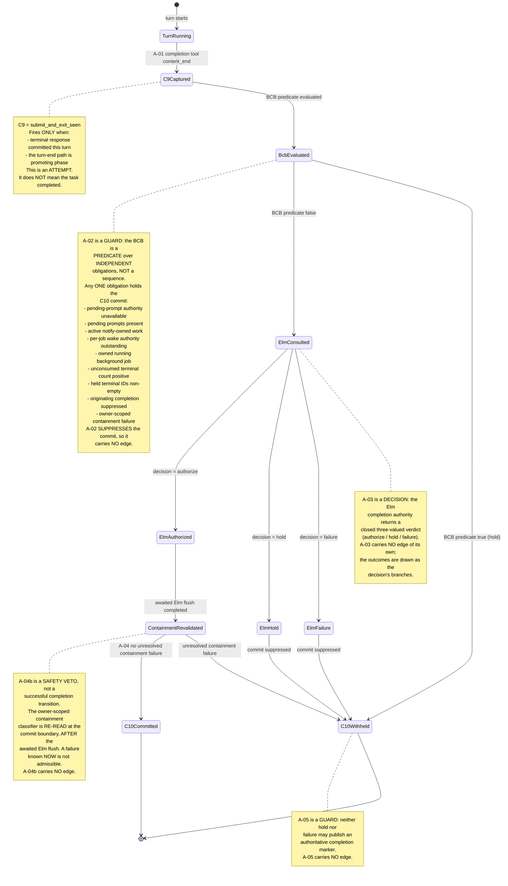

# Chart 02 — C9 / BCB / Elm / C10 Completion Authority

Who may commit task completion, and how the pieces interact.

This is the chart that explains the LIVE incident.

## The four actors

| Actor | What it is | Where |
|---|---|---|
| **C9** | `submit_and_exit_seen` — a cardinality CAPTURE that fires when the completion tool's terminal response was committed AND the turn-end path is promoting phase. **An attempt, not a completion.** | `sdk-session-event-coordinator.ts` (the `captureContinuationCardinalityAuthorityRecord({stage: "submit_and_exit_seen", submitId})` call) |
| **BCB** | Background Completion Barrier — the TS-predicate HOLD on the C10 commit. | `sdk-session-event-coordinator.ts` (the barrier block) + `background-notify-coordinator.ts` |
| **Elm** | The Elm completion-authority kernel. The MANDATORY authority for the C10 commit. No silent TS fallback. | `completion-authority-elm-authority.ts`, `completion-authority-elm-authority-runtime.ts` |
| **C10** | `task_completion_committed` — the canonical task-completion commit. Fires AT the `setTurnPhase("completed", …)` effect. **The single authority for "the task completed".** | `sdk-session-event-coordinator.ts` (the `captureContinuationCardinalityAuthorityRecord({stage: "task_completion_committed", completionId})` call) |

## The C9 → C10 chain



## Load-bearing transitions

### A-01 — C9 capture (`submit_and_exit_seen`)

| Field | Value |
|---|---|
| source | `apps/vscode/src/sdk/sdk-session-event-coordinator.ts` (the `captureContinuationCardinalityAuthorityRecord({stage: "submit_and_exit_seen", …})` call inside the turn-end promotion branch) |
| predicate | `wasAttemptCompletionSeen() && wasTerminalResponseCommittedThisTurn()` — evaluated in the turn-end path |
| effect | One bounded cardinality record with a coordinator-local monotonic `submitId`. **No phase write. No completion commit. No completionId.** |
| test | `apps/vscode/src/sdk/__tests__/completion-authority-contract01.h03.test.ts`, `apps/vscode/src/sdk/__tests__/continuation-cardinality-authority01.ccard01.test.ts` |
| kind | observed |
| claim kind | **TRANSITION** — an observable state change (a new C9 record). It is the ONLY transition into the captured-attempt state. |

**A C9 is an ATTEMPT.** The LIVE incident recorded `C9 = 2 observed
attempts` and `C10 = 0 observed commits` — two attempts, no completion.
That is the correct shape for a held task.

### A-02 — the BCB hold predicate

| Field | Value |
|---|---|
| source | `apps/vscode/src/sdk/sdk-session-event-coordinator.ts` (the barrier block) |
| predicate | `pendingPromptAuthorityUnknown \|\| pendingPromptsKnown > 0 \|\| activeNotifyCount > 0 \|\| perJobOutstandingNotifyWork \|\| ownerStillRunningForC10 \|\| heldObligationForC10 \|\| suppressOriginatingCompletion \|\| unresolvedContainmentFailuresForC10.length > 0` |
| effect | The C10 commit is NOT taken; a `DeferredCompletionBarrier` marker is registered with the `(sessionId, taskId, epoch)` triple; a bounded completion-continuation may be enqueued; the obligation can later be discharged and the held completion then commits exactly once |
| test | `apps/vscode/src/sdk/__tests__/completion-authority-contract01.h03.test.ts` (the independent-obligation matrix), `long-horizon-task-quiescence-completion-barrier01.tqcb01.test.ts`, `background-completion-barrier01.bcb01.test.ts`, `containment-failure-c10-authority-repair01.cfc10ar01.test.ts` |
| kind | observed |
| claim kind | **GUARD** — a predicate that SUPPRESSES a write. It carries NO Mermaid edge. |

**The BCB is a PREDICATE over INDEPENDENT obligations, NOT an ordered
sequence.** Any ONE obligation holds the C10 commit; they are not
visited in order and none of them implies another. The predecessor
diagram drew them as a linear chain of five states
(`PendingPromptUnknown -> PendingPromptKnown -> OutstandingAutonomousWork
-> OwnerStillRunning -> HeldObligation -> Suppressed`), which asserted a
sequencing the production code does not implement. The reconciled diagram
models the BCB as ONE evaluation with a note listing the independent
obligations, and the executable matrix drives each obligation in
isolation with all the others controlled to false.

The conjuncts:

| Conjunct | Source | Meaning |
|---|---|---|
| `pendingPromptAuthorityUnknown` | `getPendingPromptCount(...).available !== true` | Fail-closed: "do not know" ⇒ hold |
| `pendingPromptsKnown > 0` | same read | A queued prompt is outstanding |
| `activeNotifyCount > 0` | `getActiveNotifyCount(sessionId, taskId)` | A notify-owned background job is alive |
| `perJobOutstandingNotifyWork` | `hasActiveNotify(jid)` per launched jobId | Wake authority in flight for a launched job |
| `ownerStillRunningForC10` | `hasRunningBackgroundJobForOwner(sessionId)` | The owner still owns a RUNNING background job |
| `heldObligationForC10` | `getUnconsumedOwnedTerminalResultCount(sessionId)` / `getUnconsumedOwnedTerminalJobIds(sessionId, taskId)` | Terminal observations are held, not yet observed |
| `suppressOriginatingCompletion` | `wasWakeDelivered(jid)` | The wake-driven turn owns the terminal completion |
| `unresolvedContainmentFailuresForC10` | `unresolvedContainmentFailuresForOwner(getBackgroundCommandJobStates(), getBackgroundCommandJobOwners(), sessionId)` | An OWNED background job failed process containment: its process group was never proven reaped |

**The observation / containment distinction.** The conjuncts above split
into two DIFFERENT facts, and only the last one is about process safety:

- `ownerStillRunningForC10` is the manager's **active-map cardinality**
  question. `CommandJobManager.finalize()` removes a job from the active
  map on BOTH the clean path and the containment-failure path, so an
  empty active map proves nothing about the process group.
- `heldObligationForC10` is the BCB's **unconsumed terminal observation**
  count. It drains when the agent *observes* the terminal fact — which
  says nothing about whether the process group was reaped.
- `unresolvedContainmentFailuresForC10` is the **process-containment**
  fact: the job's terminal postcondition was not `gone`, so its process
  group was never proven gone. It is OWNER-SCOPED (a foreign owner's
  failure does not block; an unknown owner fails closed).

**Consuming a terminal observation is NOT resolving a containment
failure.** The two are independent facts; the executable witness drives
the case where the observation is fully drained (count 0, no held IDs)
while the containment failure is still unresolved, and asserts that the
completion STAYS held.

`unresolvedContainmentFailuresForOwner` is the SINGLE shared classifier for
that fact. It is consulted by the immediate C10 barrier (this table),
by the deferred C10 re-evaluation (`reevaluateDeferredCompletionBarrier`),
by the Q5 deferred-handoff path (`reevaluateDeferredContinuation`), and
re-validated at the actual commit boundary after the awaited Elm-authority
flush (`unresolvedContainmentFailuresAtCommitBoundary`).

### A-03 — the Elm consult

| Field | Value |
|---|---|
| source | `apps/vscode/src/sdk/sdk-session-event-coordinator.ts` (`checkElmCompletionAuthority`) |
| predicate | `getElmCompletionAuthorityDecision(sessionId)` returns `{kind: "authorize"}`. `hold` and `failure` both return `false` — **there is NO silent TS fallback** (`completion-authority-elm-authority.ts`). |
| effect | `true` → the C10 commit proceeds. `false` → the C10 commit is SUPPRESSED and a `DeferredCompletionBarrier` marker is registered (the liveness repair from `ACT-CLINEMM-COMPLETION-AUTHORITY-POST-RUN-REEVALUATION01`). |
| test | `apps/vscode/src/sdk/__tests__/completion-authority-contract01.h03.test.ts`, `apps/vscode/src/sdk/__tests__/completion-authority-elm-first-seam01.case01.test.ts`, `completion-authority-elm-real-provider01.test.ts` |
| kind | observed |
| claim kind | **DECISION** — a closed three-valued verdict. It carries NO edge of its own; the outcomes are drawn as the decision's branches. |

**The Elm kernel is fed the factual CCARD stages** through
`captureContinuationCardinalityAuthorityRecord` →
`enqueueElmAuthorityRecord`. The filter is
`AUTHORITY_STAGES` in `completion-authority-elm-authority-runtime.ts`:
it EXCLUDES the post-decision stages (`task_completion_committed`,
`completion_presented`, `task_cancelled`) so the kernel is never told
the outcome before it decides.

### A-04 — the C10 commit

| Field | Value |
|---|---|
| source | `apps/vscode/src/sdk/sdk-session-event-coordinator.ts` (`handleSessionEvent` / `reevaluateDeferredCompletionBarrier` → `setTurnPhase("completed", …)`) \| `apps/vscode/src/sdk/turn-state-tracker.ts` (`setWithWriter`) |
| predicate | ALL of: turn complete; a completion tool was seen; a terminal response was committed this turn; no error was seen; NOT (BCB hold); Elm authorized; no unresolved owner-scoped containment failure at the commit boundary |
| effect | Request `setTurnPhase("completed", undefined, "session-event-turn-complete-completed")`; `TurnStateTracker.setWithWriter` is the actual phase commit boundary; then `captureContinuationCardinalityAuthorityRecord({stage: "task_completion_committed", completionId})` — the C10 record, minted AFTER the effect |
| test | `apps/vscode/src/sdk/__tests__/completion-authority-contract01.h03.test.ts`, `apps/vscode/src/sdk/__tests__/c9-c10-commit-driven-authority-publication01.c9c10cdap01.test.ts` |
| kind | observed |
| claim kind | **TRANSITION** — an observable state change. It is the ONLY edge into the committed-completion state. |

**Elm AUTHORIZE is NECESSARY but NOT SUFFICIENT.** The final containment
revalidation (A-04b) sits between the awaited Elm flush and the commit
effect, so an authorization alone does not commit. The diagram shows the
revalidation explicitly as its own state.

### A-05 — the C10 commit is withheld (Elm HOLD / FAILURE)

| Field | Value |
|---|---|
| source | `apps/vscode/src/sdk/sdk-session-event-coordinator.ts` (`checkElmCompletionAuthority` false branch) |
| predicate | `checkElmCompletionAuthority(...) === false` |
| effect | The C10 commit is suppressed; a `DeferredCompletionBarrier` marker is registered; no authoritative marker is published or retracted. The live completion row was published without the marker, and commit-driven promotion is the only publisher. |
| test | `apps/vscode/src/sdk/__tests__/completion-authority-contract01.h03.test.ts`, `apps/vscode/src/sdk/__tests__/c9-c10-commit-driven-authority-publication01.c9c10cdap01.test.ts` |
| claim kind | **GUARD** — it SUPPRESSES a publication. It carries NO Mermaid edge. |

### A-04b — the containment safety veto

| Field | Value |
|---|---|
| source | `apps/vscode/src/sdk/sdk-session-event-coordinator.ts` (`unresolvedContainmentFailuresForOwner` at the immediate barrier, at `reevaluateDeferredCompletionBarrier`, and at the commit boundary via `unresolvedContainmentFailuresAtCommitBoundary`) |
| predicate | An OWNED background job's terminal classification is `containment_failed` (its process group was never proven reaped) — the observation may have been consumed and the manager's active map may be empty; neither proves process safety |
| effect | The C10 commit is suppressed at BOTH the immediate barrier and the deferred re-evaluation; the `DeferredCompletionBarrier` marker is preserved (not cleared); at the commit boundary the marker is re-registered; NO completed phase write, NO `task_completion_committed` capture and NO authoritative marker promotion occur |
| test | `apps/vscode/src/sdk/__tests__/completion-authority-contract01.h03.test.ts`, `apps/vscode/src/sdk/__tests__/containment-failure-c10-authority-repair01.cfc10ar01.test.ts` |
| claim kind | **SAFETY VETO** — it SUPPRESSES the commit. It is NOT a successful completion transition and carries NO Mermaid edge. |

**The veto has THREE sites.** The immediate barrier, the deferred
re-evaluation, and the commit boundary AFTER the awaited Elm flush. The
third site is the load-bearing one: `checkElmCompletionAuthority` awaits
the Elm flush before it reads the decision, and that await is a real
time-of-check / time-of-use interval in which a containment failure can
be published. The commit-boundary revalidation re-reads the SAME
owner-scoped classifier — no second Elm consult, no second BCB read — so
a failure known NOW is not admissible.

### A-06 — the completion identity

The transition ledger's A-06 is the completion-identity contract.

| Field | Value |
|---|---|
| source | `apps/vscode/src/sdk/sdk-session-event-coordinator.ts` (`this.nextCompletionCommitEventId`) |
| predicate | The C10 capture is the ONLY event-creating seam for `completionId`; the increment is monotonic per coordinator instance |
| effect | One OBSERVED C10 event ⇒ one distinct `completionId`; two real C10 commits ⇒ two distinct `completionId`s. Presentation, reopen, and BCB do NOT mint `completionId`s. |
| test | `apps/vscode/src/sdk/__tests__/completion-authority-contract01.h03.test.ts`, `apps/vscode/src/sdk/__tests__/continuation-cardinality-authority01.ccard01.test.ts` |
| claim kind | **INVARIANT** — a cardinality / identity property. It carries NO Mermaid edge. |

**A-06 IS NOT BROADENED.** The proven claim is "one observed C10 event
mints one distinct completionId, and presentation / reopen do not mint
one". The stronger claim — "there can only ever be one C10 event per
task" — is NOT separately proven and is therefore NOT asserted. The
executable witness deliberately produces TWO real C10 commits and asserts
TWO distinct completionIds, so the invariant cannot silently widen.

### A-07 — the Elm input filter

| Field | Value |
|---|---|
| source | `apps/vscode/src/sdk/completion-authority-elm-authority-runtime.ts` (`AUTHORITY_STAGES`) \| `apps/vscode/src/sdk/continuation-cardinality-authority.ts` (`captureContinuationCardinalityAuthorityRecord` → `enqueueElmAuthorityRecord`) |
| predicate | The stage is in `AUTHORITY_STAGES` (the post-decision stages are EXCLUDED) |
| effect | The Elm kernel receives only the factual pre-decision stages; a post-decision C10 outcome can never become an authority input — no outcome-to-input feedback loop |
| test | `apps/vscode/src/sdk/__tests__/completion-authority-contract01.h03.test.ts`, `apps/vscode/src/sdk/__tests__/completion-authority-elm-real-provider01.test.ts` |
| claim kind | **INPUT RULE** — a filter on what the authority may observe. It carries NO Mermaid edge. |

## The LIVE incident, traced

```
SESSION = 1792824738628_cw4og
EPOCH   = 8
C9      = 2 observed attempts
C10     = 0 observed commits
LEGACY  = streaming
UI      = Working / Cancel
ROW     = finalized completion_result
```

### What the evidence DOES establish

| Fact | Where it comes from |
|---|---|
| The task did NOT complete. | `C10 = 0` — the C10 capture is the ONLY event-creating seam for the completion commit, and it did not fire. |
| The task phase is `streaming`. | The legacy phase writer never wrote `completed`. `streaming` → TaskHeader "Working" (`taskHeaderTelemetryHelpers.ts:146`). |
| Two completion ATTEMPTS were made. | `C9 = 2` — two `submit_and_exit_seen` captures, each with a distinct monotonic `submitId`. |
| A finalized `completion_result` row exists. | The completion tool's `content_end` fired (the `content_end` is what finalizes the row). |
| A completion attempt was HELD. | The LIVE counter `C9 = 2` with `C10 = 0` is the signature of a held attempt. |

### What the evidence does NOT establish

The reported "missing terminal observation" is a **discriminator, not a
proven final cause**. Two candidate causes both produce the
`C9 = 2 / C10 = 0` signature:

1. The **TS-predicate BCB hold** (held terminal observations).
2. The **Elm authority HOLD / FAILURE**.

The LIVE row evidence discriminates between them:

| Path | What happens to the completion row |
|---|---|
| BCB (TS-predicate) hold | The **message-layer completion filter** REMOVES the row from the published set. The row is never visible to the user, so it cannot present as authoritative completion. |
| Elm HOLD / FAILURE | The row is **NOT filtered** — it stays published WITHOUT the `isAuthoritativelyCompletedResult` marker (the LIVE `content_end` never stamps it), so the webview renders no green "Completed" badge. |

**A finalized `completion_result` row that the user can SEE therefore
excludes the pure-BCB path and implicates the Elm path.**

> **HISTORICAL NOTE.** This section describes the LIVE incident as it was
> OBSERVED at the time. Under the PRE-repair design the marker was stamped
> at publication time, so an Elm HOLD left the row visible WITH the badge
> (the retraction design corrected the final projection but not the temporal
> invariant). Current HEAD does not stamp the marker at publication at all:
> the Elm HOLD leaves the row visible WITHOUT the badge, and only a
> successful C10 commit publishes the marker (P-06). The paragraph above
> states the CURRENT behaviour; the causal chain below states the historical
> defect.

### The causal chain (confirmed by the RED witness)

```
1. content_end (submit_and_exit)
   -> message-translator.ts publishes say:"completion_result",
      partial=false, WITHOUT isAuthoritativelyCompletedResult
      (the marker is promoted only by the C10 commit)

2. done event
   -> coordinator turn-end promotion branch
   -> BCB hold predicate false (no outstanding work)
   -> checkElmCompletionAuthority(...) === false   [Elm HOLD or FAILURE]

3. C10 commit SUPPRESSED
   -> setTurnPhase("completed", ...) NOT called
   -> phase stays "streaming"
   -> TaskHeader says "Working"
   -> C10 capture never fires

4. The published row carries NO isAuthoritativelyCompletedResult marker
   -> webview resolveTerminalReportFraming() has no PRIMARY marker
   -> no green "Completed" badge
```

This is the historical defect description. Current HEAD repairs it by
publishing the live row without the authority marker and promoting that
same row only from the successful C10 commit (P-06). The transition A-05
therefore means "C10 withheld / no authoritative marker published", not
"an already-published marker was retracted".

### The repair

`apps/vscode/src/sdk/sdk-session-event-coordinator.ts`:
`promoteCompletionAuthorityMarker(event)`.

The invariant is TEMPORAL: an authoritative completion must never be
PUBLISHED before its C10 commit. So the LIVE `content_end` publishes the
finalized `completion_result` row WITHOUT the
`isAuthoritativelyCompletedResult` marker, and the C10 COMMIT publishes
the marker: the coordinator re-publishes the current turn's completion
row with the SAME `ts` and the marker ADDED. The message store upserts by
`ts` and the webview's `applyMessage` reducer merges by `ts`, so the row
is replaced in place: the summary TEXT stays visible, and the
"Completed" badge appears exactly when — and only when — the C10
committed.

Both C10 paths promote the row: the immediate turn-complete path and the
deferred `reevaluateDeferredCompletionBarrier` path.

The promotion is a PUBLICATION of the C10 authority, not a second
completion authority: the C10 commit IS the authority, and the seam is
only ever called from a successful commit.

**Why the earlier retraction design was insufficient.** The first
repair stamped the marker at publication time and retracted it later
when the Elm authority rejected the completion. That is retrospective:
the webview receives the publication and the retraction as SEPARATE
messages over an event-based channel, so it can render the first one
before the second arrives — the final projection was correct, but the
temporal invariant was violated. The retraction also had a second
defect: the DEFERRED C10 path could later AUTHORIZE and COMMIT without
ever restoring the removed marker, leaving a legitimate, committed
completion with NO badge.

| kind | observed |
