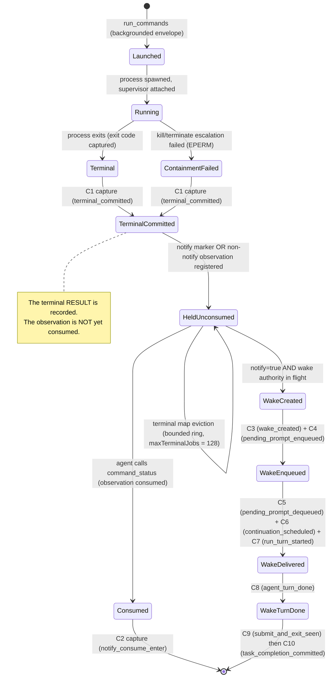

# Chart 03 — Background Command, Containment, Terminal Observation

The lifecycle of a background command and the terminal observation it
produces. This is what the BCB holds on.

**Owner:** `CommandJobManager`
(`apps/vscode/src/sdk/command-job-manager.ts`) for the job lifecycle;
`BackgroundNotifyCoordinator`
(`apps/vscode/src/sdk/background-notify-coordinator.ts`) for the
notify marker and the held terminal results.

## Load-bearing transitions

### B-01 — launch

| Field | Value |
|---|---|
| source | `apps/vscode/src/sdk/command-job-manager.ts` (the job registration) + `vscode-run-commands-tool.ts` (the backgrounded envelope) |
| predicate | The tool's output carries `{ status: "running", jobId: "cmd_…" }` |
| effect | A `CommandJob` is registered under an OWNER triple `(sessionId, taskId, ownerSessionId)`; the running command row keeps `commandCompleted = false` and `commandExecutionDisposition = "backgrounded"` |
| test | `apps/vscode/src/sdk/__tests__/background-command-completion-ownership-correlation01.bccoc01.test.ts` |
| kind | observed |

### B-02 — terminal commit (C1)

| Field | Value |
|---|---|
| source | `apps/vscode/src/sdk/command-job-manager.ts` (the `finalize` seam) |
| predicate | The supervised process exited, OR containment failed |
| effect | `captureContinuationCardinalityAuthorityRecord({stage: "terminal_committed", jobId})`; the terminal result is stored in the bounded terminal map |
| test | `apps/vscode/src/sdk/__tests__/continuation-cardinality-authority01.ccard01.test.ts` |
| kind | observed |

### B-03 — containment failure

| Field | Value |
|---|---|
| source | `apps/vscode/src/sdk/command-job-manager.ts` (the `killTree` / `terminateTree` escalation) |
| predicate | The process group did not die after the escalation |
| effect | The job is removed from the active map with a `command_containment_failed` reason; the runtime error is published to the TaskHeader telemetry strip |
| test | `apps/vscode/src/sdk/__tests__/premature-handoff-containment-failure01.phcf01.test.ts` |
| kind | observed |

**Load-bearing:** the active map is emptied on BOTH the clean path and
the containment-failure path. `hasRunningBackgroundJobForOwner` is an
ACTIVE-MAP CARDINALITY question and CANNOT answer "was the process
group reaped?". The per-job projection
(`getBackgroundCommandJobStates`) is what distinguishes them.

### B-04 — terminal observation held (the BCB's target)

| Field | Value |
|---|---|
| source | `apps/vscode/src/sdk/background-notify-coordinator.ts` (`unconsumedTerminalCountForOwner`, `unconsumedOwnedTerminalJobIdsForOwner`) |
| predicate | A terminal result is registered under the owner key `(sessionId, taskId)` and has not yet been consumed |
| effect | `getUnconsumedOwnedTerminalResultCount(sessionId) > 0` — this is the second conjunct of the frozen BCB invariant `unconsumed_owned_terminal_results == 0`. It HOLDS the C10 commit even when `running_jobs == 0`. |
| test | `apps/vscode/src/sdk/__tests__/background-completion-barrier01.bcb01.test.ts`, `held-terminal-eviction-conservation01.htec01.test.ts` |
| kind | observed |

### B-05 — terminal observation consumed

| Field | Value |
|---|---|
| source | `apps/vscode/src/sdk/background-notify-coordinator.ts` (`consumeTerminal`) |
| predicate | The agent called `command_status` for the jobId (Path B / Path C), OR the terminal event was consumed (Path A) |
| effect | The held observation is removed; the count drops; the BCB's held conjunct clears |
| test | `apps/vscode/src/sdk/__tests__/background-completion-consumer-availability01.bcca.test.ts` |
| kind | observed |

### B-06 — terminal map eviction (the bounded-ring hazard)

| Field | Value |
|---|---|
| source | `apps/vscode/src/sdk/command-job-manager.ts` (the `terminal.delete(evictId)` eviction) |
| predicate | The bounded terminal map exceeds `maxTerminalJobs` (default 128) |
| effect | The evicted jobId is no longer resolvable via `manager.status(evictedId)` (`{ ok: false, code: "unknown_job" }`). A compact receipt recorded at the manager's terminal-event seam keeps the held obligation resolvable. |
| test | `apps/vscode/src/sdk/__tests__/held-terminal-eviction-conservation01.htec01.test.ts`, `held-terminal-eviction-conservation02.htec02.test.ts` |
| kind | observed |

### B-07 — wake creation and delivery

| Field | Value |
|---|---|
| source | `apps/vscode/src/sdk/background-notify-coordinator.ts` (`formatTerminalWakePrompt` + `enqueueTerminalWake`) |
| predicate | The job is notify-owned AND the wake authority is in flight |
| effect | C3 (`wake_created`) → C4 (`pending_prompt_enqueued`) → C5 (`pending_prompt_dequeued`) → C6 (`continuation_scheduled`) → C7 (`run_turn_started`) → C8 (`agent_turn_done`) |
| test | `apps/vscode/src/sdk/__tests__/background-notify-exactly-once-presentation01.bcnex01.test.ts` |
| kind | observed |

### B-08 — per-job wake authority states

| Field | Value |
|---|---|
| source | `apps/vscode/src/sdk/sdk-session-event-coordinator.ts` (the per-job loop in the C10 barrier) |
| predicate | `hasActiveNotify(jid)` → HOLD; `wasWakeDispatchRequested(jid) && !wasWakeDelivered(jid) && !wasWakeDispatchFailed(jid)` → HOLD; `wasWakeDelivered(jid)` → SUPPRESS the originator; `wasWakeDispatchFailed(jid)` → ALLOW the originator |
| effect | Per-job, not aggregate. An unrelated alive job does NOT suppress an unrelated completion. |
| test | `apps/vscode/src/sdk/__tests__/background-notify-completion-authority-c10-framework01.bnca-framework01.test.ts` |
| kind | observed |

### B-09 — a background job from a FOREIGN session

| Field | Value |
|---|---|
| source | `apps/vscode/src/sdk/SdkController.ts` (`getUnconsumedOwnedTerminalResultCount`, `getUnconsumedOwnedTerminalJobIds`) |
| predicate | The owner key is `(sessionId, taskId)`; a job owned by another session/task does NOT match |
| effect | A foreign session's held observations neither HOLD nor RELEASE this task's completion |
| test | `apps/vscode/src/sdk/__tests__/completion-presentation-authority01.cpa01.test.ts` (CPA-05) |
| kind | observed |
