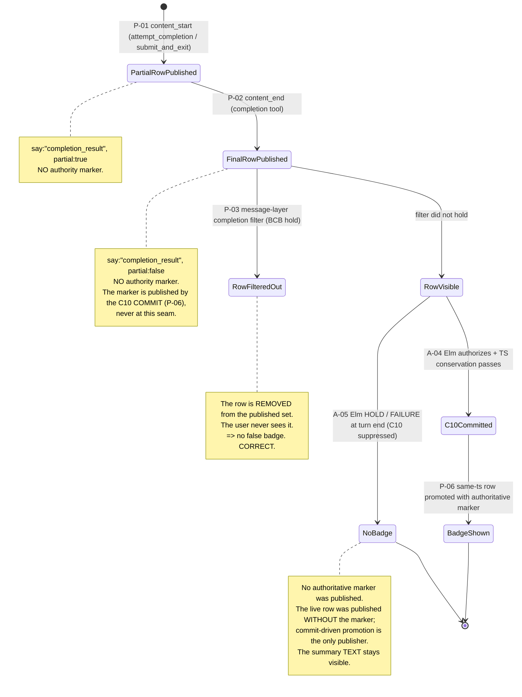

# Chart 04 — Completion Message / Presentation Lifecycle

How a completion attempt becomes a VISIBLE "Completed" badge — and
where that badge can disagree with the task's actual completion state.

This is the chart that contains the defect repaired by this ACT.

## The two authorities

| Authority | Scope | Source |
|---|---|---|
| **Row marker** `isAuthoritativelyCompletedResult` | ONE row: "this row WAS a terminal completion". Monotonic — survives phase flips, resume, retry, follow-up, compaction. | The **C10 commit** publishes it: `apps/vscode/src/sdk/sdk-session-event-coordinator.ts` (`promoteCompletionAuthorityMarker`). The **RESTORATION** path stamps it from a verified persisted completion identity (`apps/vscode/src/sdk/message-translator.ts`, `finalizePersistedToolUse`). The LIVE `content_end` never stamps it. |
| **Task phase** `turnState.phase` | The WHOLE TASK: "what is the task doing right now". Mutable. | `apps/vscode/src/sdk/turn-state-tracker.ts` |

They answer DIFFERENT questions and must not be confused. A historical
completion row must keep its badge while a NEWER turn runs (the phase
is then `streaming`). That is why the marker exists.

**The defect was that the marker was stamped as an UNCONDITIONAL
assertion of authority at PUBLICATION time, while the authority to
actually commit the task's completion is decided LATER.**

## The publication path



**P-04 and P-05 are PROJECTION / INVARIANT claims, not transitions.**
They are therefore NOT Mermaid edges: P-04 is the pure webview projection
(`resolveTerminalReportFraming`) that turns a marked row into the green
"Completed" badge, and P-05 is the convergence invariant that makes the
same-`ts` promotion possible (host store upsert + webview reducer merge).
Both have contract entries and executable assertions below.

## The executable conformance contract

Every claim below has ONE stable id, ONE production symbol, ONE executable
witness, ONE observed assertion, and ONE evidence status. The rows are
GENERATED by `bun scripts/verify-completion-presentation-contract.ts`, which
runs the witness suite and derives each `result` from the OBSERVED test
outcome — never from a static declaration. The machine-readable artifact is
[`coverage-report.tsv`](../../acts/ACT-CLINEMM-LIFECYCLE-EXECUTABLE-PRESENTATION-CONTRACT01/coverage-report.tsv);
the human rendering is
[`coverage-report.md`](../../acts/ACT-CLINEMM-LIFECYCLE-EXECUTABLE-PRESENTATION-CONTRACT01/coverage-report.md).

| claim_id | kind | source symbol | witness | observed assertion | evidence status |
|---|---|---|---|---|---|
| P-01 | TRANSITION | `message-translator.ts#agentEventToMessages` | `completion-presentation-contract01.cpc01.test.ts` | `content_start` publishes `say:"completion_result"` with `partial:true` and NO `isAuthoritativelyCompletedResult` marker. | REAL_PRODUCTION_SEAM |
| P-02 | TRANSITION | `message-translator.ts#agentEventToMessages` (LIVE) / `#finalizePersistedToolUse` (RESTORATION) | `completion-presentation-contract01.cpc01.test.ts` | LIVE `content_end` finalizes WITHOUT the marker; RESTORATION stamps it ONLY from the verified persisted completion identity. The two paths are exercised SEPARATELY. | REAL_PRODUCTION_SEAM |
| P-03 | GUARD | `sdk-session-event-coordinator.ts#handleSessionEvent` (the `hasCompletionResult` filter block) | `completion-presentation-contract01.cpc01.test.ts` | Where the BCB policy filters the row, the turn publishes NO completion row (owned running job / held terminal observation / foreign-session observation). BCB filtration is NOT conflated with Elm authorization. | INJECTED_DECISION |
| P-04 | PROJECTION | `terminalReportFraming.ts#resolveTerminalReportFraming` | `completion-presentation-contract01.cpc01.test.ts` | Modern SDK rows need the authoritative marker; the legacy `ask:"completion_result"` fallback keeps its independent phase-gated conditions; plan mode yields no badge; authority is NOT inferred from the current phase. | REAL_PRODUCTION_SEAM |
| P-05 | INVARIANT | `task-proxy.ts#MessageStateHandler.addMessages` / `messageReducer.ts#applyMessage` | `completion-presentation-contract01.cpc01.test.ts` | The same-`ts` promotion updates the row IN PLACE in BOTH the host store and the real webview reducer: one visible row, preserved `ts`, preserved summary text. | REAL_PRODUCTION_SEAM |
| P-06 | TRANSITION | `sdk-session-event-coordinator.ts#promoteCompletionAuthorityMarker` / `#checkElmCompletionAuthority` / `turn-state-tracker.ts#setWithWriter` | `completion-presentation-contract01.cpc01.test.ts` | On BOTH the immediate and deferred C10 paths: authority -> effect request -> OBSERVED commit -> promotion -> one authoritative row. A HOLD produces no current-turn marker; a failed publication is never recorded as a success. | INJECTED_DECISION |
| P-07 | INVARIANT | `message-translator.ts#sdkMessagesToClineMessages` | `completion-presentation-contract01.cpc01.test.ts` | Reopen through the REAL restoration translation agrees with the live row: committed retains the marker, held acquires none, a historical identity is not overwritten by a newer turn, and the legacy semantics are unchanged. | REAL_PRODUCTION_SEAM |

The `INJECTED_DECISION` evidence level means the Elm decision is INJECTED at
the existing provider boundary (`getElmCompletionAuthorityDecision`). Every
other seam in those claims is production code. **No live Elm execution and
no installed-extension live capture is claimed.**


## Load-bearing transitions

### P-01 — the partial row

| Field | Value |
|---|---|
| source | `apps/vscode/src/sdk/message-translator.ts` (the completion-tool branch of the `content_start` case) |
| predicate | `isCompletionTool(toolName)` |
| effect | `say:"completion_result"`, `partial: true`. **No authority marker.** `setAttemptCompletionSeen()`. |
| test | `apps/vscode/src/sdk/__tests__/completion-presentation-contract01.cpc01.test.ts` (P-01), `apps/vscode/src/sdk/__tests__/message-translator.test.ts` |
| kind | TRANSITION |

### P-02 — the finalized row + the authority marker

| Field | Value |
|---|---|
| source | `apps/vscode/src/sdk/message-translator.ts` (the completion-tool branch of the `content_end` case) |
| predicate | `isCompletionTool(toolName)`; LIVE path: the marker is NEVER stamped at publication (the C10 commit publishes it). RESTORATION path: `event.isAuthoritativeCompletion === true` stamps it. |
| effect | `say:"completion_result"`, `partial: false`, `setTerminalResponseCommittedThisTurn()`; the `isAuthoritativelyCompletedResult: true` marker is added by the C10 COMMIT (see P-06) on the LIVE path, or stamped directly on the RESTORATION path. |
| test | `apps/vscode/src/sdk/__tests__/completion-presentation-contract01.cpc01.test.ts` (P-02 LIVE + P-02 RESTORATION), `terminal-report-cardinality-repair01.trcr01.test.ts` |
| kind | TRANSITION |

**The `event.isAuthoritativeCompletion` escape hatch** is the
PERSISTED-TRANSCRIPT restoration path
(`finalizePersistedToolUse`): when a completion attempt was HELD (a
runtime-control `completion_continuation_control` user message follows
it in the transcript), the marker is omitted on restore, so the reopened
task renders the held summary WITHOUT the badge. The held-vs-committed
distinction is read from the persisted runtime-control marker, NOT from
message ordering.

**Before this ACT** the LIVE path always stamped the marker
(`eventAuthority !== false` with `eventAuthority === undefined`), i.e.
the marker was PUBLISHED at `content_end` — BEFORE the C10 commit
decision — and a later retraction corrected it. The LIVE path now
stamps NOTHING (`eventAuthority === true` is required, and only the
restoration path passes an explicit bit), so the marker is published
BY the C10 commit (P-06).

### P-03 — the message-layer completion filter (the BCB projection)

| Field | Value |
|---|---|
| source | `apps/vscode/src/sdk/sdk-session-event-coordinator.ts` (the `hasCompletionResult` filter block) |
| predicate | `result.messages.some(m => m.say === "completion_result")` AND (narrow branch) an OWNED job has an active notify marker, OR `ownerStillRunningForC10`, OR `unconsumedOwnedTerminalResultsForC10 > 0`; (fallback branch) `pendingPromptAuthorityUnknown \|\| pendingPromptsKnown > 0 \|\| activeNotifyCount > 0 \|\| ownerStillRunningForC10 \|\| unconsumedOwnedTerminalResultsForC10 > 0` |
| effect | `result.messages = result.messages.filter(m => m.say !== "completion_result")` — the row is REMOVED from the published set |
| test | `apps/vscode/src/sdk/__tests__/completion-presentation-contract01.cpc01.test.ts` (P-03 owned-running / held-observation / foreign-session / Elm-HOLD), `apps/vscode/src/sdk/__tests__/completion-presentation-authority01.cpa01.test.ts` |
| kind | GUARD |

**This filter and the BCB barrier must reach the SAME conclusion** about
whether the task is currently authoritatively complete. The
`ACT-CLINEMM-COMPLETION-PRESENTATION-AUTHORITY01` repair extended this
filter to also consult `hasRunningBackgroundJobForOwner` and
`getUnconsumedOwnedTerminalResultCount` — the same option-bag methods
the barrier uses.

### P-04 — the webview authority projection

| Field | Value |
|---|---|
| source | `apps/vscode/webview-ui/src/components/chat/terminalReportFraming.ts` (`resolveTerminalReportFraming`) |
| predicate | PRIMARY: `message.isAuthoritativelyCompletedResult === true`. SECONDARY (legacy only): `turnState.phase === "completed"` AND the row is a legacy `ask:"completion_result"` with non-empty text. `mode === "plan"` → `undefined` always. |
| effect | `undefined` (no badge) OR `{kind: "completed", label: "Completed", ariaLabel: "Task completed", title: "Task completed successfully"}` |
| test | `apps/vscode/src/sdk/__tests__/completion-presentation-contract01.cpc01.test.ts` (P-04 modern / plan / legacy / phase-transition), `apps/vscode/webview-ui/src/components/chat/terminalReportFraming.test.ts` |
| kind | PROJECTION |

The projection is PURE: no React, no DOM, no I/O, no message-tail
inference. It MUST NOT infer "Completed" from message text, from the
message tail, or from the mutable task phase alone.


### P-05 — the message store upsert

| Field | Value |
|---|---|
| source | `apps/vscode/src/sdk/task-proxy.ts` (`MessageStateHandler.addMessages`) and `apps/vscode/webview-ui/src/components/chat/chat-view/messageReducer.ts` (`applyMessage`) |
| predicate | A message with the same `ts` REPLACES the stored row in place (host) / merges by `ts` (webview) |
| effect | This is what makes commit-driven promotion possible: re-publishing a row with the same `ts` updates it in place without creating a new visible row. |
| test | `apps/vscode/src/sdk/__tests__/completion-presentation-contract01.cpc01.test.ts` (P-05 host store + webview reducer), `apps/vscode/webview-ui/src/components/chat/chat-view/messageReducer.test.ts` |
| kind | INVARIANT |

### P-06 — the commit-driven authority publication (THIS ACT's repair)

| Field | Value |
|---|---|
| source | `apps/vscode/src/sdk/sdk-session-event-coordinator.ts` (`promoteCompletionAuthorityMarker`), invoked at the C10 commit on BOTH paths — the immediate turn-complete path (`handleSessionEvent`) and the deferred `reevaluateDeferredCompletionBarrier` path |
| predicate | The C10 commit SUCCEEDED (the Elm authority returned `authorize` AND every conservation check passed) AND the coordinator published a completion row for THIS turn |
| effect | The row is re-published with the SAME `ts` and the marker ADDED, via `emitHookMessage` (the established "update a message" channel — store-append + direct webview push, NO session-event emission). The summary TEXT survives; the badge appears exactly when — and only when — the C10 committed. |
| test | `apps/vscode/src/sdk/__tests__/completion-presentation-contract01.cpc01.test.ts` (P-06 immediate / deferred / HOLD / FAILURE + NEG-01/02/03), `apps/vscode/src/sdk/__tests__/c9-c10-commit-driven-authority-publication01.c9c10cdap01.test.ts` (RED-04, RED-05) |
| kind | TRANSITION |

**The invariant is TEMPORAL.** An authoritative completion must never be
PUBLISHED before its C10 commit. The live `content_end` therefore
publishes the finalized `completion_result` row WITHOUT the
`isAuthoritativelyCompletedResult` marker; the C10 COMMIT publishes the
marker.

**Why the earlier retraction design was insufficient.** The C9C10SCR01
repair stamped the marker at publication time and retracted it later
when the Elm authority rejected the completion. That is
*retrospective*: the webview receives the publication and the retraction
as SEPARATE messages over an event-based channel, so it can render the
first one before the second arrives. The final projection was correct,
but the temporal invariant was violated. The retraction also had a
second defect: the DEFERRED C10 path could later AUTHORIZE and COMMIT
without ever restoring the removed marker, leaving a legitimate,
committed completion with NO badge.

**Why `emitHookMessage` and not `appendAndEmit`:** `appendAndEmit` is
the "publish NEW rows" channel and it EMITS a session event. The
promotion is an UPDATE to an existing row, so it uses the update
channel. This keeps the published-row cardinality unchanged (the
existing `CPA-09` / `CPA-04` / `C10-BASELINE-02` contracts count
published rows).

**Bounded scope.** The promotion target is turn-scoped: the
coordinator tracks the row it published for the CURRENT turn
(`pendingCompletionAuthorityRow`) and clears that tracking at
the turn boundary (`pending_prompt_submitted`). A historical
completion row from a previous epoch is never touched — so
"Preserve historical completion summaries when a newer epoch is
running" holds.

**It is NOT a second completion authority.** The C10 commit IS the
authority; this seam merely publishes that authority to the
presentation layer. The seam is only ever called from a successful C10
commit, and it can only ADD the marker to the row the coordinator
itself published for the current turn.

### P-07 — the reopen path

| Field | Value |
|---|---|
| source | `apps/vscode/src/sdk/message-translator.ts` (`sdkMessagesToClineMessages` → `finalizePersistedToolUse`) |
| predicate | The persisted transcript contains a runtime-control `completion_continuation_control` user message in the interval `(toolResultIdx, nextCompletionToolUseIdx)` |
| effect | The restored row OMITS the marker (held) or carries it (committed). The live and reopen paths AGREE on `isAuthoritativelyCompletedResult`. |
| test | `apps/vscode/src/sdk/__tests__/completion-presentation-contract01.cpc01.test.ts` (P-07 committed / held / historical-identity / legacy), `terminal-report-cardinality-repair01.trcr01.test.ts` |
| kind | INVARIANT |

## Why the row marker is NOT the completion authority

| Question | Answered by |
|---|---|
| "Did THIS ROW represent a terminal completion attempt?" | The row marker. |
| "Did THE TASK complete?" | The C10 commit (`task_completion_committed`). |
| "Is the task working right now?" | `turnState.phase`. |

The ACT's invariant ties the first two together for the CURRENT turn:

```
Current-turn authoritative completion display
  => C10 committed for the same owner/epoch
```

Before this ACT the implication could be violated: the marker was
stamped unconditionally at publication, and the C10 commit could be
suppressed afterwards by the Elm authority. P-06 closes that gap.
