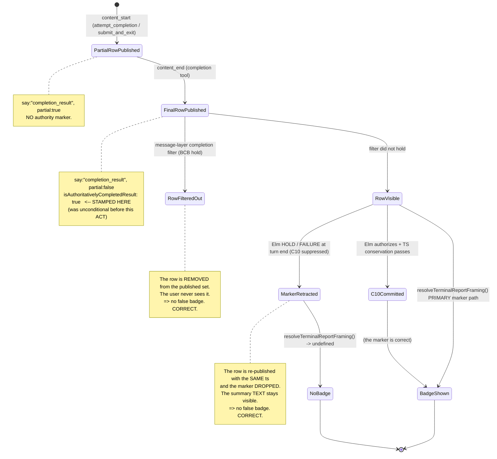

# Chart 04 — Completion Message / Presentation Lifecycle

How a completion attempt becomes a VISIBLE "Completed" badge — and
where that badge can disagree with the task's actual completion state.

This is the chart that contains the defect repaired by this ACT.

## The two authorities

| Authority | Scope | Source |
|---|---|---|
| **Row marker** `isAuthoritativelyCompletedResult` | ONE row: "this row WAS a terminal completion". Monotonic — survives phase flips, resume, retry, follow-up, compaction. | Stamped at `apps/vscode/src/sdk/message-translator.ts` (the completion tool's `content_end`) |
| **Task phase** `turnState.phase` | The WHOLE TASK: "what is the task doing right now". Mutable. | `apps/vscode/src/sdk/turn-state-tracker.ts` |

They answer DIFFERENT questions and must not be confused. A historical
completion row must keep its badge while a NEWER turn runs (the phase
is then `streaming`). That is why the marker exists.

**The defect was that the marker was stamped as an UNCONDITIONAL
assertion of authority at PUBLICATION time, while the authority to
actually commit the task's completion is decided LATER.**

## The publication path




## Load-bearing transitions

### P-01 — the partial row

| Field | Value |
|---|---|
| source | `apps/vscode/src/sdk/message-translator.ts` (the completion-tool branch of the `content_start` case) |
| predicate | `isCompletionTool(toolName)` |
| effect | `say:"completion_result"`, `partial: true`. **No authority marker.** `setAttemptCompletionSeen()`. |
| test | `apps/vscode/src/sdk/__tests__/message-translator.test.ts` |
| kind | observed |

### P-02 — the finalized row + the authority marker

| Field | Value |
|---|---|
| source | `apps/vscode/src/sdk/message-translator.ts` (the completion-tool branch of the `content_end` case) |
| predicate | `isCompletionTool(toolName)`; `event.isAuthoritativeCompletion !== false` |
| effect | `say:"completion_result"`, `partial: false`, `isAuthoritativelyCompletedResult: true`; `setTerminalResponseCommittedThisTurn()` |
| test | `apps/vscode/src/sdk/__tests__/message-translator.test.ts`, `terminal-report-cardinality-repair01.trcr01.test.ts` |
| kind | observed |

**The `event.isAuthoritativeCompletion === false` escape hatch** is the
PERSISTED-TRANSCRIPT restoration path
(`finalizePersistedToolUse`): when a completion attempt was HELD (a
runtime-control `completion_continuation_control` user message follows
it in the transcript), the marker is omitted on restore, so the reopened
task renders the held summary WITHOUT the badge. The held-vs-committed
distinction is read from the persisted runtime-control marker, NOT from
message ordering.

**Before this ACT** the LIVE path always stamped the marker
(`eventAuthority !== false` with `eventAuthority === undefined`).

### P-03 — the message-layer completion filter (the BCB projection)

| Field | Value |
|---|---|
| source | `apps/vscode/src/sdk/sdk-session-event-coordinator.ts` (the `hasCompletionResult` filter block) |
| predicate | `result.messages.some(m => m.say === "completion_result")` AND (narrow branch) an OWNED job has an active notify marker, OR `ownerStillRunningForC10`, OR `unconsumedOwnedTerminalResultsForC10 > 0`; (fallback branch) `pendingPromptAuthorityUnknown \|\| pendingPromptsKnown > 0 \|\| activeNotifyCount > 0 \|\| ownerStillRunningForC10 \|\| unconsumedOwnedTerminalResultsForC10 > 0` |
| effect | `result.messages = result.messages.filter(m => m.say !== "completion_result")` — the row is REMOVED from the published set |
| test | `apps/vscode/src/sdk/__tests__/completion-presentation-authority01.cpa01.test.ts`, `background-command-terminal-presentation-arbitration01.bctpa01.test.ts` |
| kind | observed |

**This filter and the BCB barrier must reach the SAME conclusion** about
whether the task is currently authoritatively complete. The
`ACT-CLINEMM-COMPLETION-PRESENTATION-AUTHORITY01` repair extended this
filter to also consult `hasRunningBackgroundJobForOwner` and
`getUnconsumedOwnedTerminalResultCount` — the same option-bag methods
the barrier uses.

### P-04 — the webview authority projection

| Field | Value |
|---|---|
| source | `apps/vscode/webview-ui/src/components/chat/terminalReportFraming.ts` (`resolveTerminalReportFraming`) |
| predicate | PRIMARY: `message.isAuthoritativelyCompletedResult === true`. SECONDARY (legacy only): `turnState.phase === "completed"` AND the row is a legacy `ask:"completion_result"` with non-empty text. `mode === "plan"` → `undefined` always. |
| effect | `undefined` (no badge) OR `{kind: "completed", label: "Completed", ariaLabel: "Task completed", title: "Task completed successfully"}` |
| test | `apps/vscode/webview-ui/src/components/chat/terminalReportFraming.test.ts`, `CompletionOutputRow.test.tsx` |
| kind | observed |

The projection is PURE: no React, no DOM, no I/O, no message-tail
inference. It MUST NOT infer "Completed" from message text, from the
message tail, or from the mutable task phase alone.


### P-05 — the message store upsert

| Field | Value |
|---|---|
| source | `apps/vscode/src/sdk/task-proxy.ts` (`MessageStateHandler.addMessages`) and `apps/vscode/webview-ui/src/components/chat/chat-view/messageReducer.ts` (`applyMessage`) |
| predicate | A message with the same `ts` REPLACES the stored row in place (host) / merges by `ts` (webview) |
| effect | This is what makes the retraction seam possible: re-publishing a row with the same `ts` updates it in place without creating a new visible row. |
| test | `apps/vscode/webview-ui/src/components/chat/chat-view/messageReducer.test.ts` |
| kind | observed |

### P-06 — the marker retraction (THIS ACT's repair)

| Field | Value |
|---|---|
| source | `apps/vscode/src/sdk/sdk-session-event-coordinator.ts:1266` (`retractCompletionAuthorityMarker`), invoked at `:3765`; the tracking field is set at `:3219` and cleared at `:2995` |
| predicate | The C10 commit was SUPPRESSED (the Elm authority returned `hold` or `failure`) AND the coordinator published a completion row carrying the marker for THIS turn |
| effect | The row is re-published with the SAME `ts` and the marker DROPPED, via `emitHookMessage` (the established "update a message" channel — store-append + direct webview push, NO session-event emission). The summary TEXT survives; the false badge does not. |
| test | `apps/vscode/src/sdk/__tests__/c9-c10-statechart-causal-repair01.c9c10scr01.test.ts` (RED-03) |
| kind | observed |

**Why `emitHookMessage` and not `appendAndEmit`:** `appendAndEmit` is
the "publish NEW rows" channel and it EMITS a session event. The
retraction is an UPDATE to an existing row, so it uses the update
channel. This keeps the published-row cardinality unchanged (the
existing `CPA-09` / `CPA-04` / `C10-BASELINE-02` contracts count
published rows).

**Bounded scope.** The retraction target is turn-scoped: the
coordinator tracks the row it published for the CURRENT turn
(`publishedAuthoritativeCompletionRow`) and clears that tracking at
the turn boundary (`pending_prompt_submitted`). A historical
completion row from a previous epoch is never touched — so
"Preserve historical completion summaries when a newer epoch is
running" holds.

**It can only REMOVE the authority claim, never add one.** It is a
presentation correction, not a second completion authority.

### P-07 — the reopen path

| Field | Value |
|---|---|
| source | `apps/vscode/src/sdk/message-translator.ts` (`sdkMessagesToClineMessages` → `finalizePersistedToolUse`) |
| predicate | The persisted transcript contains a runtime-control `completion_continuation_control` user message in the interval `(toolResultIdx, nextCompletionToolUseIdx)` |
| effect | The restored row OMITS the marker (held) or carries it (committed). The live and reopen paths AGREE on `isAuthoritativelyCompletedResult`. |
| test | `apps/vscode/src/sdk/__tests__/terminal-report-duplication-corr01.trd01.test.ts`, `terminal-report-cardinality-repair01.trcr01.test.ts` |
| kind | observed |

## Why the row marker is NOT the completion authority

| Question | Answered by |
|---|---|
| "Did THIS ROW represent a terminal completion attempt?" | The row marker. |
| "Did THE TASK complete?" | The C10 commit (`task_completion_committed`). |
| "Is the task working right now?" | `turnState.phase`. |

The ACT's invariant ties the first two together for the CURRENT turn:

```
Current-turn authoritative completion display
  => C10 committed for the same owner/epoch
```

Before this ACT the implication could be violated: the marker was
stamped unconditionally at publication, and the C10 commit could be
suppressed afterwards by the Elm authority. P-06 closes that gap.
